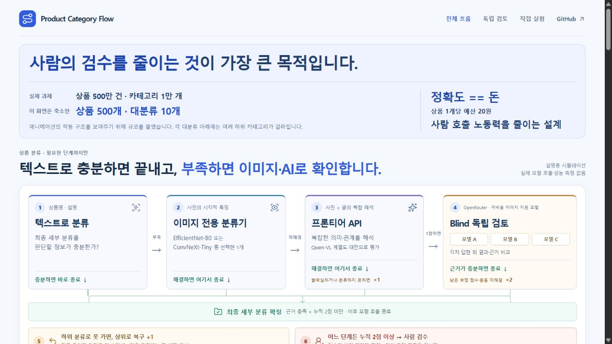
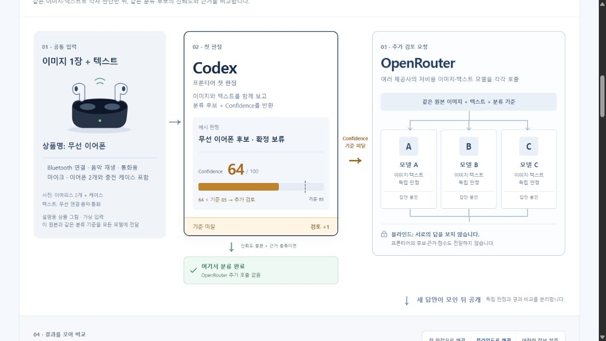
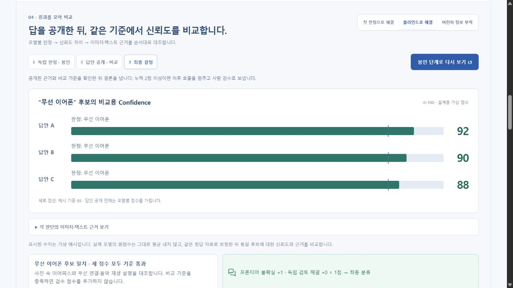
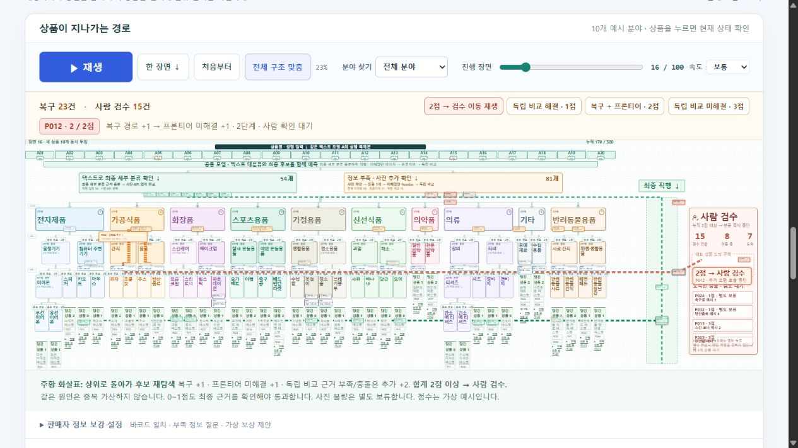
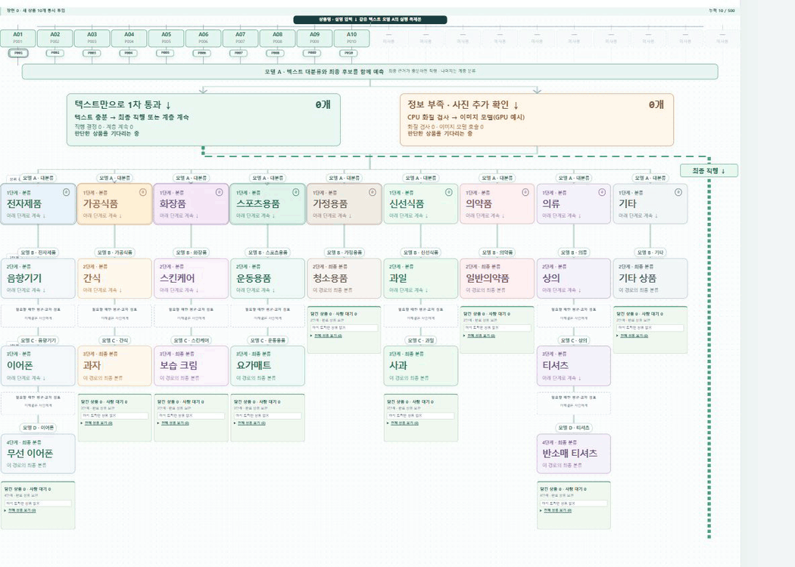

# 500만 상품의 단계별 분류 흐름 시뮬레이터

**사람의 검수를 줄이는 것이 가장 큰 목적입니다.** 상품명·설명으로 충분하면 최종 분류를 끝내고, 어려운 상품에만 이미지 전용 분류기와 추가 AI 검토를 사용하는 **분류 설계의 실행 가능한 시각화**입니다.

**[▶ 웹에서 직접 실행하기](https://product-category-flow.pages.dev/)**



## 과제와 축소판

과제는 **상품 500만 건·카테고리 1만 개**입니다. 애니메이션의 작동 구조를 보여주기 위해 **가상 상품 500개·대분류 10개·최종 분류 38개**로 줄였습니다. 전체 분류 노드는 66개이며, 의류의 상의·하의처럼 같은 층에 여러 하위 후보가 있습니다.

**정확도 == 돈 · 상품당 평균 예산 20원.** 총 1억 원을 500만 상품으로 나눈 예산 기준입니다. 학습·서버·API·사람 검수·오분류 수정 비용을 함께 비교해야 합니다. 실제 처리비용이나 달성한 정확도가 아닙니다.

## 필요한 단계까지만 실행

1. **텍스트로 분류:** 최종 세부 분류를 특정할 근거가 충분하면 바로 종료합니다.
2. **이미지 전용 분류기 1개:** 텍스트로 해결되지 않은 상품의 사진을 확인합니다. 해결되면 종료합니다.
3. **프론티어 API:** 전용 분류기로 해결하지 못한 사진·글의 복합 의미를 해석하는 단계입니다. 불확실하거나 분류하지 못하면 검수 점수 **+1**입니다.
4. **OpenRouter 독립 검토:** 이미지 입력을 지원하는 저비용 모델들이 같은 상품 정보와 분류 기준을 각각 받습니다. 첫 판정에는 서로의 답이나 앞선 프론티어의 답을 주지 않습니다. 답을 모은 뒤 결과·근거를 비교하고, 점수가 낮거나 충돌이 해결되지 않으면 **+2를 추가**합니다.
5. **경로 복구:** 잘못된 가지에 들어가거나 다음 하위 후보로 진행하지 못하면 상위로 돌아가 대체 후보를 찾고 **+1**입니다.
6. **즉시 사람 검수:** 점수가 늘 때마다 확인해 **누적 2점 이상이면 이후 모델 호출을 생략**합니다.

각 단계에서 근거를 충족하고 누적 점수가 2점 미만이면 최종 분류를 마칩니다. 복구는 같은 사건을 중복 가산하지 않으며, 데모에서는 대체 분기 탐색을 1회로 제한합니다. 사진을 읽을 수 없거나 복구 후보가 소진되면 2점 미만이어도 보류할 수 있습니다.

| 예시 | 결과 |
| --- | --- |
| 프론티어 미해결 +1 → 독립 검토로 해결 +0 | 1점, 근거 충족 후 분류 |
| 복구 +1 → 프론티어 미해결 +1 | 2점, 독립 검토 전에 사람 검수 |
| 프론티어 미해결 +1 → 독립 검토 미해결 +2 | 3점, 사람 검수 |

이 순서와 점수는 웹 데모의 상태 전환에 반영되어 있습니다. 모델 응답 자체는 고정한 가상 사례입니다.

## 이미지 모델 비교 계획

**EfficientNet-B0와 ConvNeXt-Tiny를 같은 상품·정답으로 비교한 뒤 사용할 모델을 선택**합니다. 운영 중 모든 상품에 두 모델을 연달아 실행하는 구성이 아닙니다. 현재 데모는 EfficientNet-B0 한 개를 쓰는 상황을 표시합니다. 실제 두 모델의 학습·추론·비교 실험은 아직 실행하지 않았습니다.

공개 기본 가중치의 ImageNet 1,000개 분류는 과제의 1만 개 상품 분류와 다릅니다. 상품 분류표에 맞춘 학습과 별도로 보관한 정답 상품의 평가가 필요합니다. 같은 평가 자료에서 최종 분류 정확도, 자동 처리 비율, 오류, 지연, 처리량, 비용을 비교해야 합니다. Qwen-VL 계열은 복합 해석 단계의 별도 비교 후보입니다.

모델이 스스로 매긴 확신도 숫자를 그대로 평균 내지는 않습니다. 같은 후보를 기준으로 정답 데이터에 맞춰 보정한 점수와 근거 일치 여부를 함께 확인하는 설계입니다. **현재 가상 점수는 보정된 확률이나 모델 평가 결과가 아닙니다.**

## 프론티어 이후의 블라인드 검토

[독립 검토 화면](https://product-category-flow.pages.dev/#agent-debate)은 **원본 이미지 1장과 텍스트 → Codex 프론티어 첫 판정 → 신뢰도가 기준보다 낮을 때 OpenRouter → 블라인드 독립 답안을 공개한 뒤 비교**를 보여줍니다. 첫 판정의 신뢰도와 예시 기준선 85를 표시하고, 근거와 기준을 충족하면 여기서 종료합니다. 주 시뮬레이션에서 프론티어 단계까지 온 상품을 설명하는 별도의 예시입니다.



모델 A·B·C에는 같은 원본과 분류 기준을 전달하고, 앞선 프론티어의 후보·근거·점수와 다른 모델의 답은 전달하지 않습니다. **세 답안 공개**를 누른 뒤에만 판정과 신뢰도 막대가 나타납니다. 모든 막대는 동일한 ‘무선 이어폰’ 후보에 대한 비교용 점수입니다. 이미지·텍스트 근거는 접기 표에서 확인합니다.



첫 판정에서 충분하면 0점으로 종료합니다. 추가 독립 검토로 해결하면 누적 1점에서 분류하고, 여전히 불확실하면 +2를 더해 누적 3점으로 사람 검수에 보냅니다. 세 사례와 92·90·88 등의 점수는 미리 작성한 가상 값입니다. 실제 모델의 원점수는 그대로 평균 내지 않고 같은 정답 자료로 보정한 뒤 근거와 함께 비교해야 합니다. 실제 저비용 모델 선정·호출·비용 측정·보정은 수행하지 않았습니다.

## 직접 조작하기

- 분류도는 처음부터 **전체 구조 맞춤** 상태입니다. **직접 실험**이나 **분류 과정 재생**을 누르면 10개 분야·직행 통로·사람 검수 구역이 함께 보입니다. 상세 정보는 분류도 아래에 있습니다.
- **독립 검토 예시**에서는 첫 판정 통과·블라인드로 해결·정보 부족의 세 사례를 바꿀 수 있습니다. 답안 봉인 → 공개·신뢰도 그래프 → 최종 결정을 넘겨 보고, 근거 표와 상세 의견 9개는 접기 영역에서 확인합니다.
- **독립 비교 해결 · 1점 / 복구 + 프론티어 · 2점 / 독립 비교 미해결 · 3점** 버튼은 가상 상품의 해당 장면으로 이동합니다.
- **2점 → 검수 이동 재생**은 실제 누적 2점 상품이 분류를 멈추고 오른쪽 사람 검수 구역으로 날아가는 장면을 재생합니다. 검수 전환·이동 중·도착 수를 나누어 표시하며, 도착 후에는 대기 목록에 남습니다.
- **분야 찾기**는 전체 배율을 유지한 채 해당 분야를 강조합니다. 진행 막대, 재생·정지·초기화로 경로와 결과를 살펴봅니다.
- 반려동물 분야와 최종 직행 통로 사이에 여백을 확보했습니다. 분야명·판단 상자·검수 표시를 키웠으며, 작은 화면의 세부 글자는 아래 상세 카드에서 확인할 수 있습니다.
- 판매자 정보 보강과 1차 텍스트 작업자 자동 확장 설정은 분류도 아래 접기 영역에 있습니다. 보상을 켜거나 끄면 가상 응답과 분류 경로가 바뀝니다. 실제 조회·연락·지급·서버 생성은 없습니다.

기본 설정의 마지막 결과는 **분류 완료 338개·사람 검수 162개**입니다. 고정 시나리오의 계산 결과이며 정확도·예상 검수율을 추정한 수치가 아닙니다.

## 실행과 검증

단일 파일인 `index.html`을 브라우저에서 열거나 [웹 데모](https://product-category-flow.pages.dev/)를 이용합니다. 외부 CDN·API 연결 없이 동작합니다.

```bash
node tests/test-text-first.cjs
node tests/test-direct-route.cjs
node tests/test-seller-enrichment.cjs
node tests/test-recovery-score.cjs
node tests/test-taxonomy.cjs
node tests/test-cascade.cjs
node tests/test-human-sector.cjs
node tests/test-blind-review.cjs
```

상태 전환, 조기 종료, 합산·중복 방지, 2점 도달 후 추가 호출 방지, 독립 입력, 최종 후보 검증, 복구 한도, 500개 보존과 초기화를 검사합니다. PC·모바일의 화면·조작 검수는 [설계 기록](docs/submission-design.md)에 남겼습니다.



**구현하지 않은 범위:** 실제 모델·OpenRouter/API 호출, 학습·확신도 보정, 실제 500만 건 처리, 1만 개 분류 학습, 사람의 검수 처리·학습 반영, 성능·비용 벤치마크.

<details>
<summary>이전 9개 분야 버전의 실행 GIF</summary>



분류 트리 확대와 현재 정책 적용 전의 기록입니다. 현재 동작은 위 웹 데모를 기준으로 확인하세요.

</details>

## 구현과 출처

사용자가 문제와 처리 순서를 정하고, Codex를 활용해 화면·시뮬레이션·검사를 구현하고 수정했습니다. 2026.10.28의 PAL 설계 검토 기록은 접기 영역에 별도로 보존했습니다. 현재 상품 분류의 실제 모델 호출이나 이미지 모델 선정 기록이 아닙니다.

아이콘은 [Lucide Static](https://lucide.dev/guide/static) 1.63.0입니다. 과거 검토 기록의 브랜드 로고는 [Lobe Icons](assets/model-logos/README.md)이며 라이선스를 보존했습니다. 상품 그림·분류도는 자체 SVG입니다.

- [EfficientNet-B0 공식 문서](https://docs.pytorch.org/vision/main/models/generated/torchvision.models.efficientnet_b0.html)
- [ConvNeXt-Tiny 공식 문서](https://docs.pytorch.org/vision/main/models/generated/torchvision.models.convnext_tiny.html)
- [OpenRouter 이미지 입력 문서](https://github.com/OpenRouterTeam/docs/blob/main/guides/overview/multimodal/image-understanding.mdx)
- [On Calibration of Modern Neural Networks](https://proceedings.mlr.press/v70/guo17a.html)
- [AWS 대기열 기반 작업자 확장](https://docs.aws.amazon.com/AmazonECS/latest/developerguide/service-autoscaling-queue.html)
- [Kaufland 상품 정보 가이드](https://www.kauflandglobalmarketplace.com/en/seller-university/selling/product-data/product-data-guideline/)
