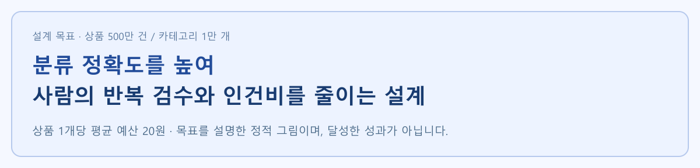
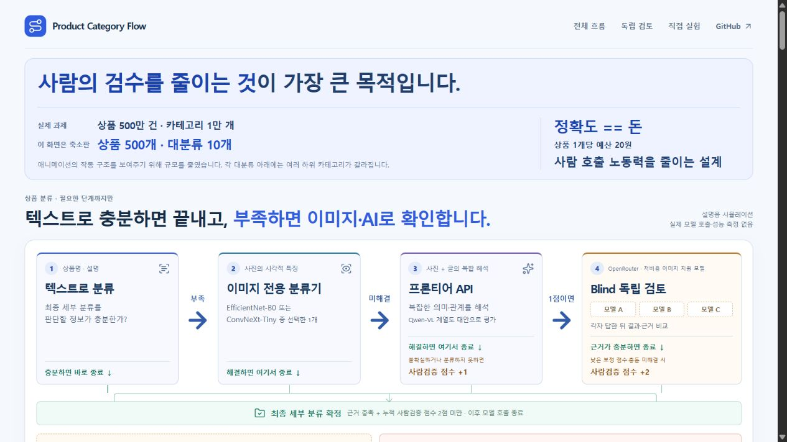
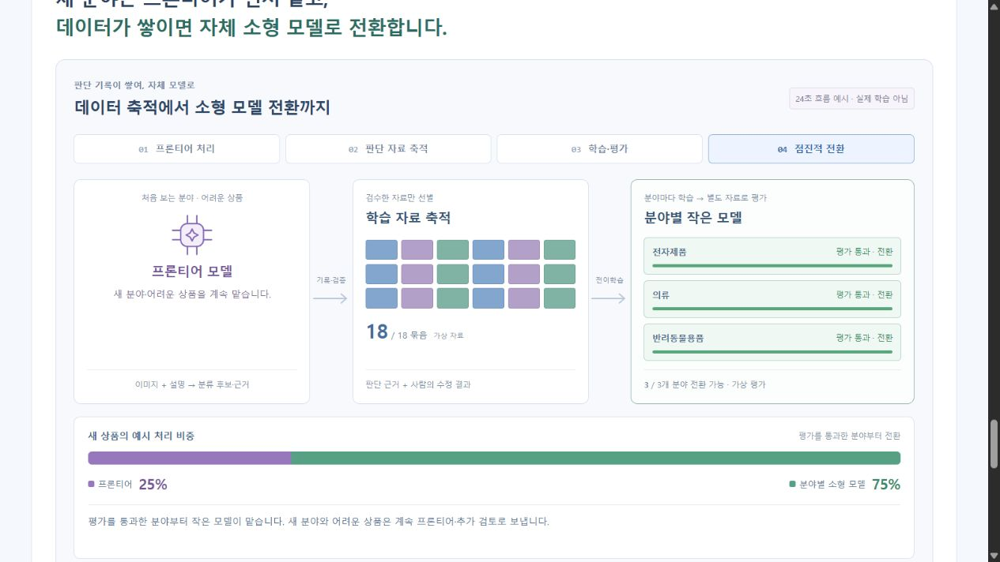
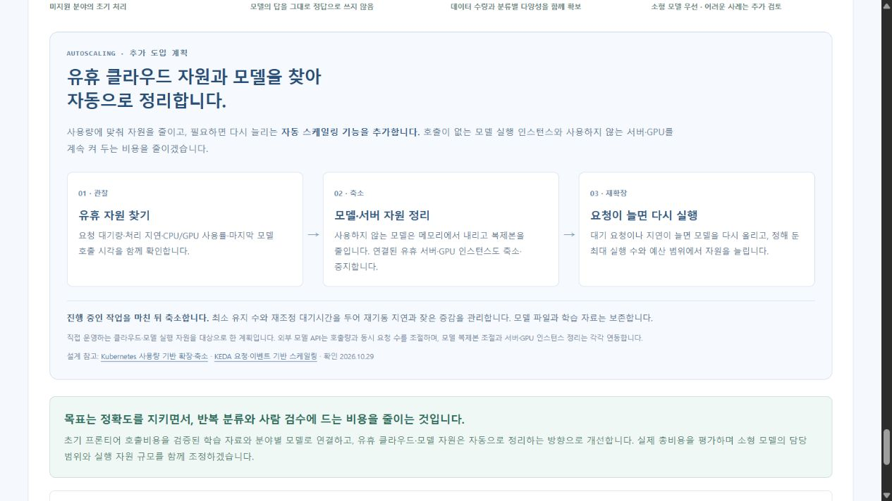
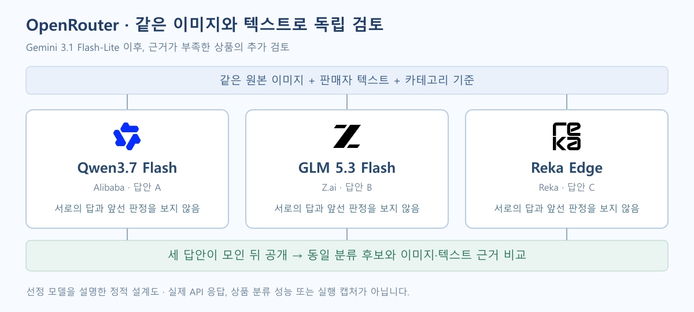
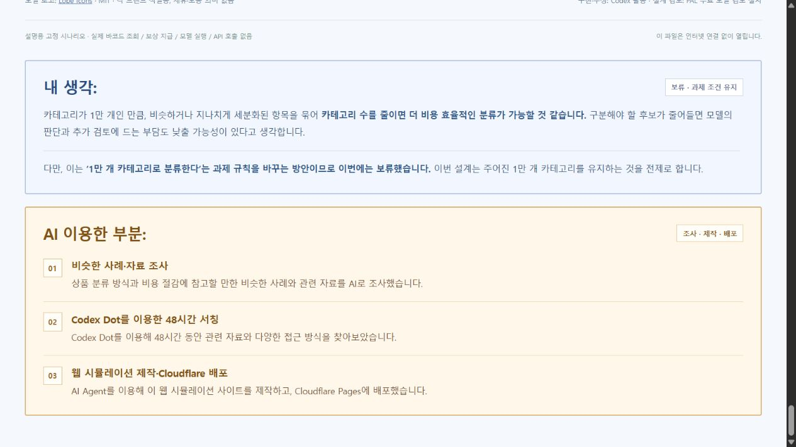
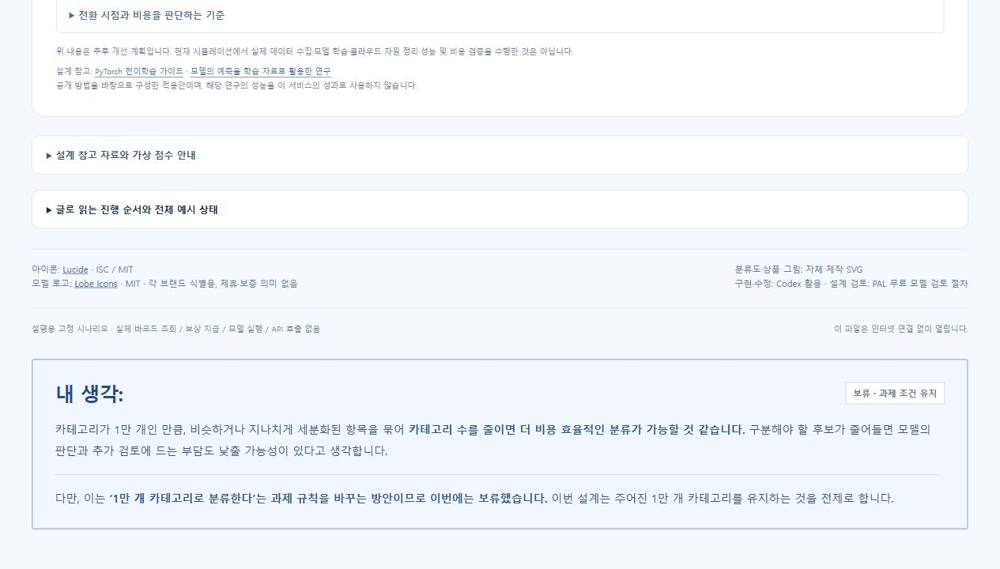

# 500만 상품의 단계별 분류 흐름 시뮬레이터

**사람의 검수를 줄이는 것이 가장 큰 목적입니다.** 상품명·설명으로 충분하면 최종 분류를 끝내고, 어려운 상품에만 이미지 전용 분류기와 추가 AI 검토를 사용하는 **분류 설계의 실행 가능한 시각화**입니다.

**[▶ 웹에서 직접 실행하기](https://product-category-flow.pages.dev/)**



## AI Agent를 적극 활용하는 이유

상단과 [추후 개선 영역](https://product-category-flow.pages.dev/#future-improvements)에 **2023.10~2026.10.28 성능 기준별 최저 토큰 단가**를 원자료에서 직접 그린 SVG로 표시합니다. GPT-4 수준은 **$37.50 → $0.0575, 약 652분의 1(99.8% 감소)**입니다. 입력 3 : 출력 1로 혼합한 100만 토큰당 미국 달러이며, LMArena의 각 성능 기준을 충족한 모델·제공처 중 최저 표준 API 단가를 비교합니다. 같은 모델 제품의 가격 추이나 이 서비스의 비용 절감 성과는 아닙니다.

출처: [Gravity / Aryan Agarwal](https://gravity.fast/data/llm-api-price-history/#price-by-tier), [CC BY 4.0](https://creativecommons.org/licenses/by/4.0/). 자료 기준 2026.10.28, 확인 2026.10.29. [CSV·비교 기준·한계](assets/data/README.md)를 함께 보관했습니다. 세 곡선, 결측 구간과 중간 상승 구간을 유지했습니다.

장기적인 단가 하락을 기대하며 사람의 반복 검수를 줄이는 AI Agent 활용에 투자한다는 관점을 담았습니다. **향후 하락은 전망**이며, 정확도·추가 호출·사람 검수·자체 소형 모델의 총비용을 함께 비교해 도입을 판단합니다.

## 과제와 축소판

과제는 **상품 500만 건·카테고리 1만 개**입니다. 애니메이션의 작동 구조를 보여주기 위해 **가상 상품 500개·대분류 10개·최종 분류 38개**로 줄였습니다. 전체 분류 노드는 66개이며, 의류의 상의·하의처럼 같은 층에 여러 하위 후보가 있습니다.

**분류 정확도를 높여 사람의 반복 검수와 인건비를 줄이는 설계 · 상품당 평균 예산 20원.** 총 1억 원을 500만 상품으로 나눈 예산 기준입니다. 학습·서버·API·사람 검수·오분류 수정 비용을 함께 비교해야 합니다. 실제 처리비용이나 달성한 정확도가 아닙니다.

## 필요한 단계까지만 실행



1. **텍스트로 분류:** 최종 세부 분류를 특정할 근거가 충분하면 바로 종료합니다.
2. **이미지 전용 분류기 1개:** 텍스트로 해결되지 않은 상품의 사진을 확인합니다. 해결되면 종료합니다.
3. **프론티어 API:** 전용 분류기로 해결하지 못한 사진·글의 복합 의미를 해석하는 단계입니다. 불확실하거나 분류하지 못하면 **사람검증 점수 +1**입니다.
4. **OpenRouter 독립 검토:** 이미지 입력을 지원하는 저비용 모델들이 같은 상품 정보와 분류 기준을 각각 받습니다. 첫 판정에는 서로의 답이나 앞선 프론티어의 답을 주지 않습니다. 답을 모은 뒤 결과·근거를 비교하고, 낮은 보정 점수·충돌 미해결 시 **사람검증 점수 +2**를 더합니다.
5. **경로 복구:** 잘못된 가지에 들어가거나 다음 하위 후보로 진행하지 못하면 상위로 돌아가 대체 후보를 찾고 **사람검증 점수 +1**입니다.
6. **즉시 사람 검수:** 점수가 늘 때마다 확인해 **누적 사람검증 점수가 2점 이상이면 이후 모델 호출을 생략**합니다.

사람검증 점수는 사람이 확인해야 할 필요성을 누적하는 규칙 점수이며, 모델의 신뢰도와는 다릅니다. 각 단계에서 근거를 충족하고 누적 사람검증 점수가 2점 미만이면 최종 분류를 마칩니다. 복구는 같은 사건을 중복 가산하지 않으며, 데모에서는 대체 분기 탐색을 1회로 제한합니다. 사진을 읽을 수 없거나 복구 후보가 소진되면 2점 미만이어도 보류할 수 있습니다.

| 사람검증 점수 누적 예시 | 결과 |
| --- | --- |
| 프론티어 미해결 +1 → 독립 검토로 해결 +0 | 1점, 근거 충족 후 분류 |
| 복구 +1 → 프론티어 미해결 +1 | 2점, 독립 검토 전에 사람 검수 |
| 프론티어 미해결 +1 → 독립 검토 미해결 +2 | 3점, 사람 검수 |

이 순서와 점수는 웹 데모의 상태 전환에 반영되어 있습니다. 모델 응답 자체는 고정한 가상 사례입니다.

## 이미지 모델 비교 계획

**EfficientNet-B0와 ConvNeXt-Tiny를 같은 상품·정답으로 비교한 뒤 사용할 모델을 선택**합니다. 운영 중 모든 상품에 두 모델을 연달아 실행하는 구성이 아닙니다. 현재 데모는 EfficientNet-B0 한 개를 쓰는 상황을 표시합니다. 실제 두 모델의 학습·추론·비교 실험은 아직 실행하지 않았습니다.

공개 기본 가중치의 ImageNet 1,000개 분류는 과제의 1만 개 상품 분류와 다릅니다. 상품 분류표에 맞춘 학습과 별도로 보관한 정답 상품의 평가가 필요합니다. 같은 평가 자료에서 최종 분류 정확도, 자동 처리 비율, 오류, 지연, 처리량, 비용을 비교해야 합니다. Qwen-VL 계열은 복합 해석 단계의 별도 비교 후보입니다.

모델이 스스로 매긴 확신도 숫자를 그대로 평균 내지는 않습니다. 같은 후보를 기준으로 정답 데이터에 맞춰 보정한 점수와 근거 일치 여부를 함께 확인하는 설계입니다. **현재 가상 점수는 보정된 확률이나 모델 평가 결과가 아닙니다.**

## 추후 개선 방향: 전이학습·자동 스케일링·조건부 캐시

### 1. 검증된 데이터가 쌓이면 자체 소형 모델로 전환

[시뮬레이션 아래의 개선 계획](https://product-category-flow.pages.dev/#future-improvements)에 초기 전이학습과 장기 전환 흐름을 추가했습니다. 공개 이미지 모델의 학습된 특징을 재사용하고, 상품 분류표에 맞게 마지막 분류층과 필요한 부분을 추가 학습하는 계획입니다.

1. 기존 모델이 아직 배우지 못한 분야는 프론티어 모델이 우선 처리합니다.
2. 이미지·분류 후보·근거·점수·사람의 수정 결과를 모으고, 검수한 자료를 학습에 사용합니다.
3. 해당 분야의 충분하고 다양한 자료로 자체 소형 이미지 모델을 학습합니다.
4. 별도로 보관한 정답 상품에서 정확도와 총비용을 평가해 통과한 분야부터 전환합니다. 불확실하거나 이미지로 구분하기 어려운 사례에는 추가 검토 경로를 유지합니다.

초기 프론티어 비용을 검증된 학습 자료와 분야별 모델로 연결해, 정확도를 지키면서 사람 검수와 반복 분류 비용을 줄이는 것이 목표입니다. **향후 계획이며 실제 수집·학습·성능 및 비용 검증을 수행한 결과가 아닙니다.** 데이터 수량만으로 전환하거나 모델의 답을 그대로 정답으로 사용하는 방식을 제안하지 않습니다.

[24초 전환 애니메이션](https://product-category-flow.pages.dev/#future-learning)에서 **흐름 재생**을 누르면 판단 자료가 쌓이고, 전자제품·의류·반려동물용품 모델이 학습·평가를 거쳐 차례로 처리 비중을 늘립니다. 학습에 쓰지 않은 자료의 평가를 통과한 뒤에만 해당 분야로 전환하며, 새 분야와 어려운 상품은 프론티어에 남습니다. 재생·일시정지·초기화, 장면 선택, 진행 막대, 동작 줄이기를 지원합니다.



18개 자료 묶음, 3개 분야, 프론티어 100%에서 25%로의 변화는 흐름을 설명하기 위한 가상 값입니다. 실제 학습량·평가 결과·비용 절감률이 아닙니다.

### 2. 유휴 클라우드·모델 자원 자동 정리

[자동 스케일링 도입 계획](https://product-category-flow.pages.dev/#future-autoscaling)을 추가했습니다. **사용량 관찰 → 유휴 자원 축소·중지 → 요청 증가 시 재확장**으로 서버·GPU·모델 실행 자원을 조절하는 방향입니다.

대기 요청·지연·CPU/GPU 사용률·마지막 호출 시각을 함께 보고, 진행 중인 작업이 끝난 뒤 사용하지 않는 모델을 메모리에서 내리거나 복제본을 줄입니다. 서버·GPU 인스턴스의 축소·중지도 별도로 연동합니다. 최소 유지 수·최대 실행 수·예산·재조정 대기시간을 두며 모델 파일과 학습 자료는 보존합니다. 외부 API는 호출량과 동시 요청 수를 조절합니다.

**추후 도입 계획이며 실제 클라우드 자원을 탐색·중지한 기능은 아닙니다.** 기존 화면의 가상 복제본 확장 시뮬레이션과 구분합니다. 설계 참고: [Kubernetes HPA](https://kubernetes.io/docs/concepts/workloads/autoscaling/horizontal-pod-autoscale/), [KEDA 이벤트 기반 스케일링](https://keda.sh/docs/2.21/concepts/scaling-deployments/).



### 3. 정답과 재사용 비율 확인 후 캐시 도입

[조건부 캐시 도입 계획](https://product-category-flow.pages.dev/#future-cache)을 추가했습니다. 상품 데이터와 검증된 정답이 충분히 쌓인 뒤, **전체 상품의 중복 비율과 안전한 결과 재사용 비율을 구분해 측정**합니다. 상품명·설명·이미지 경로·모델이 계산한 특징·확인된 최하위 분류를 DB에 연결하고 입력·모델·분류 기준 버전을 함께 관리하는 방향입니다.

검증된 동일 입력의 결과는 앞단에서 재사용을 검토합니다. 일부 텍스트·이미지가 비슷한 경우에는 후보만 검색하고, 같은 최하위 분류라는 근거를 확인한 뒤 재사용합니다. 기존 특징을 활용하는 작은 정답·반례 저장소는 비싼 API 호출 직전에서 시험하며, 불확실하면 기존 분류 경로를 유지합니다.

기존 방식과 비교해 오분류 기준을 충족하고, 생략한 처리비가 구축·저장·검색·검증·오류 수정의 추가 비용보다 클 때 일부 분야부터 적용합니다. **추후 개선 방향의 3번 항목이며, 실제 DB 캐시 연동·중복률 측정·비용 절감 검증을 구현하거나 수행한 결과는 아닙니다.** 기존 1번 소형 모델 전환, 2번 유휴 자원 자동 정리에 이어 배치했습니다.

설계 참고: [AWS 이미지·설명 특징의 DB 저장·검색 구현안](https://docs.aws.amazon.com/solutions/visual-search-on-aws/) · [Shopify 유사 상품 후보 검색 후 검증](https://shopify.engineering/leveraging-multimodal-llms).

## 프론티어 이후의 블라인드 검토

**사람의 반복 검수를 줄이기 위해 AI 에이전트의 교차 검증을 적극 활용한다**는 설계 관점을 화면에 크게 표시했습니다. 추가 토큰으로 정확도를 유지하고 사람 검수 건수를 줄일 수 있다면, 필요한 검증에 투자하는 방향입니다. 판단 기준은 사람 검수·오분류 수정까지 합친 전체 비용이며, 미해결 예외는 사람에게 보냅니다.

비용 추세는 [Stanford AI Index 2025](https://hai.stanford.edu/ai-index/2025-ai-index-report)의 같은 성능 기준 추론비용 하락을 근거로 설명했습니다. 개별 모델의 모든 토큰 가격이나 미래 가격을 단정하지 않습니다. 이 서비스의 실제 비용 절감 실험 결과는 아닙니다.

[독립 검토 화면](https://product-category-flow.pages.dev/#agent-debate)은 **원본 이미지 1장과 텍스트 → Codex 프론티어 첫 판정 → 신뢰도가 기준보다 낮을 때 OpenRouter → 블라인드 독립 답안을 공개한 뒤 비교**를 보여줍니다. 첫 판정의 신뢰도와 예시 기준선 85를 표시하고, 근거와 기준을 충족하면 여기서 종료합니다. 주 시뮬레이션에서 프론티어 단계까지 온 상품을 설명하는 별도의 예시입니다.



카드 A·B·C는 각각 Qwen3.7 Flash·GLM 5.3 Flash·Reka Edge를 배치한 예시입니다. 같은 원본과 분류 기준을 전달하고, 앞선 프론티어의 후보·근거·점수와 다른 모델의 답은 전달하지 않는 설계를 보여줍니다. **세 답안 공개**를 누른 뒤에만 판정과 신뢰도 막대가 나타납니다. 모든 막대는 동일한 ‘무선 이어폰’ 후보에 대한 가상 비교 점수이며 해당 모델의 실제 성능이 아닙니다. 실제 연결에는 선택 모델의 이미지 입력 지원을 별도로 확인해야 합니다. 이미지·텍스트 근거는 접기 표에서 확인합니다.


첫 판정에서 충분하면 0점으로 종료합니다. 추가 독립 검토로 해결하면 누적 1점에서 분류하고, 여전히 불확실하면 +2를 더해 누적 3점으로 사람 검수에 보냅니다. 세 사례와 92·90·88 등의 점수는 미리 작성한 가상 값입니다. 실제 모델의 원점수는 그대로 평균 내지 않고 같은 정답 자료로 보정한 뒤 근거와 함께 비교해야 합니다. 실제 저비용 모델 선정·호출·비용 측정·보정은 수행하지 않았습니다.

## 직접 조작하기

- 분류도는 처음부터 **전체 구조 맞춤** 상태입니다. **직접 실험**이나 **분류 과정 재생**을 누르면 10개 분야·직행 통로·사람 검수 구역이 함께 보입니다. 선택한 상품의 검수 점수와 판단 요약은 분류도 위에서 확인합니다.
- **독립 검토 예시**에서는 첫 판정 통과·블라인드로 해결·정보 부족의 세 사례를 바꿀 수 있습니다. 답안 봉인 → 공개·신뢰도 그래프 → 최종 결정을 넘겨 보고, 근거 표와 상세 의견 9개는 접기 영역에서 확인합니다.
- **독립 비교 해결 · 1점 / 복구 + 프론티어 · 2점 / 독립 비교 미해결 · 3점** 버튼은 가상 상품의 해당 장면으로 이동합니다.
- **2점 → 검수 이동 재생**은 실제 누적 2점 상품이 분류를 멈추고 오른쪽 사람 검수 구역으로 날아가는 장면을 재생합니다. 검수 전환·이동 중·도착 수를 나누어 표시하며, 도착 후에는 대기 목록에 남습니다.
- **분야 찾기**는 전체 배율을 유지한 채 해당 분야를 강조합니다. 진행 막대, 재생·정지·초기화로 경로와 결과를 살펴봅니다.
- 반려동물 분야와 최종 직행 통로 사이에 여백을 확보했습니다. 분야명·판단 상자·검수 표시를 키웠습니다. 페이지 길이를 줄이기 위해 단계별 병렬 상품 목록과 개별 상품 상세 카드는 제거했습니다.
- 판매자 정보 보강과 1차 텍스트 작업자 자동 확장 설정은 분류도 아래 접기 영역에 있습니다. 보상을 켜거나 끄면 가상 응답과 분류 경로가 바뀝니다. 실제 조회·연락·지급·서버 생성은 없습니다.

기본 설정의 마지막 결과는 **분류 완료 338개·사람 검수 162개**입니다. 고정 시나리오의 계산 결과이며 정확도·예상 검수율을 추정한 수치가 아닙니다.

## 실행과 검증

단일 파일인 `index.html`을 브라우저에서 열거나 [웹 데모](https://product-category-flow.pages.dev/)를 이용합니다. 외부 CDN·API 연결 없이 동작합니다.

```bash
node tests/test-text-first.cjs
node tests/test-direct-route.cjs
node tests/test-seller-enrichment.cjs
node tests/test-recovery-score.cjs
node tests/test-taxonomy.cjs
node tests/test-cascade.cjs
node tests/test-human-sector.cjs
node tests/test-blind-review.cjs
node tests/test-future-learning.cjs
node tests/test-token-price.cjs
```

상태 전환, 조기 종료, 합산·중복 방지, 2점 도달 후 추가 호출 방지, 독립 입력, 최종 후보 검증, 복구 한도, 500개 보존과 초기화를 검사합니다. PC·모바일의 화면·조작 검수는 [설계 기록](docs/submission-design.md)에 남겼습니다.

개선 애니메이션은 자료 누적, 평가 전 전환 차단, 처리 비중 합계 100%, 재생·정지·초기화·장면 이동, 동작 줄이기와 숨긴 탭에서 정지, 기존 분류 시뮬레이션에 영향을 주지 않는지를 별도로 검사합니다.


**구현하지 않은 범위:** 실제 모델·OpenRouter/API 호출, 학습·확신도 보정, 실제 500만 건 처리, 1만 개 분류 학습, 사람의 검수 처리·학습 반영, 성능·비용 벤치마크.

<details>
<summary>이전 9개 분야 버전의 실행 GIF</summary>


분류 트리 확대와 현재 정책 적용 전의 기록입니다. 현재 동작은 위 웹 데모를 기준으로 확인하세요.

</details>

## 구현과 출처

사용자가 문제와 처리 순서를 정하고, Codex를 활용해 화면·시뮬레이션·검사를 구현하고 수정했습니다. 2026.10.28의 PAL 설계 검토 기록은 접기 영역에 별도로 보존했습니다. 현재 상품 분류의 실제 모델 호출이나 이미지 모델 선정 기록이 아닙니다.

아이콘은 [Lucide Static](https://lucide.dev/guide/static) 1.63.0입니다. Gemini·Qwen·Z.ai·Reka의 브랜드 로고는 [Lobe Icons](assets/model-logos/README.md)이며 원본 색상·형태와 라이선스를 보존했습니다. 상품 그림·분류도는 자체 SVG입니다.

- [EfficientNet-B0 공식 문서](https://docs.pytorch.org/vision/main/models/generated/torchvision.models.efficientnet_b0.html)
- [ConvNeXt-Tiny 공식 문서](https://docs.pytorch.org/vision/main/models/generated/torchvision.models.convnext_tiny.html)
- [OpenRouter 이미지 입력 문서](https://github.com/OpenRouterTeam/docs/blob/main/guides/overview/multimodal/image-understanding.mdx)
- [On Calibration of Modern Neural Networks](https://proceedings.mlr.press/v70/guo17a.html)
- [PyTorch 전이학습 가이드](https://docs.pytorch.org/tutorials/beginner/transfer_learning_tutorial.html)
- [예측 라벨을 학습 자료로 활용한 Noisy Student 연구](https://research.google/pubs/self-training-with-noisy-student-improves-imagenet-classification/)
- [AWS 대기열 기반 작업자 확장](https://docs.aws.amazon.com/AmazonECS/latest/developerguide/service-autoscaling-queue.html)
- [Kaufland 상품 정보 가이드](https://www.kauflandglobalmarketplace.com/en/seller-university/selling/product-data/product-data-guideline/)

## 내가 한 부분

[본인 기여 영역](https://product-category-flow.pages.dev/#my-contribution)에는 작성자가 제안하고 조정한 아홉 가지를 구분해 담았습니다. AI Agent 간 의견·근거 비교, 실제 사용 중인 OpenRouter의 적극 활용, 사람 검수 누적점수제, 오픈소스·전이학습 활용, 사람 검수 인건비 최소화, 토큰 비용 감소 전망에 따른 AI 활용, 어려운 분야를 초기에는 프론티어 모델로 처리하며 데이터·검증된 정답을 모은 뒤 작은 모델로 전환하는 방식, 프론티어 API 사용을 최소화하는 구조, 애니메이션 웹 서비스 UI·UX 구성·조정입니다. 이 아홉 항목은 작성자의 기여로, 사례 조사·복구 루트 제안·이미지 전용 분류기 아이디어·각 단계의 구체적인 모델 서칭 및 추천·웹 구현·배포는 아래의 AI 활용 영역으로 구분합니다. OpenRouter 실제 사용은 작성자가 밝힌 경험이며 이 정적 시뮬레이션의 실시간 API 호출을 뜻하지 않습니다.

UI·UX 구성·조정을 포함한 최신 기여 목록은 [웹사이트 본문](https://product-category-flow.pages.dev/#my-contribution)에서 확인할 수 있습니다.

## AI 이용한 부분

[‘내가 한 부분:’ 다음의 AI 활용 영역](https://product-category-flow.pages.dev/#ai-use)에 Walmart·Rakuten·Meta·Shopify 등 세계 여러 기업의 사례 조사와 의견 제공, Walmart 사례 조사 과정에서 AI가 제안한 복구 루트, 이미지 전용 분류기 아이디어와 각 단계의 구체적인 모델 서칭 및 추천을 명시했습니다. 모델 후보에는 KoELECTRA-Small-v3, EfficientNet-B0·ConvNeXt-Tiny, Gemini 3.5 Flash-Lite, Qwen3.7 Flash·GLM 5.3 Flash·Reka Edge가 포함됩니다. Codex Dot를 이용한 48시간 서칭, AI Agent를 활용한 웹 시뮬레이션 제작과 Cloudflare Pages 배포도 함께 담았습니다. 아이디어 출처와 48시간 서칭은 작성자의 설명에 따른 기록이며, 복구 루트가 Walmart의 실제 구현과 동일하다는 뜻은 아닙니다.



## 내 생각: 카테고리 축소는 보류

[페이지 마지막의 의견](https://product-category-flow.pages.dev/#my-thoughts)에는 비슷하거나 지나치게 세분화된 항목을 묶어 카테고리 수를 줄이면 분류 비용을 낮출 가능성이 있다는 생각을 담았습니다. 다만 **1만 개 카테고리로 분류한다는 과제 규칙을 바꾸는 방안이므로 이번에는 보류**했습니다. 현재 설계는 주어진 1만 개 카테고리를 유지하는 전제입니다.



화면은 전체 흐름 → 상품 이동 애니메이션 → 독립 검토 설명·결과 비교 순서로 배치했습니다. 1단계 텍스트 모델은 `monologg/koelectra-small-v3-discriminator`를 우선 추가 학습 후보로 명시했으며, 아직 이번 상품 분류용으로 학습·성능 측정한 결과는 아닙니다.
