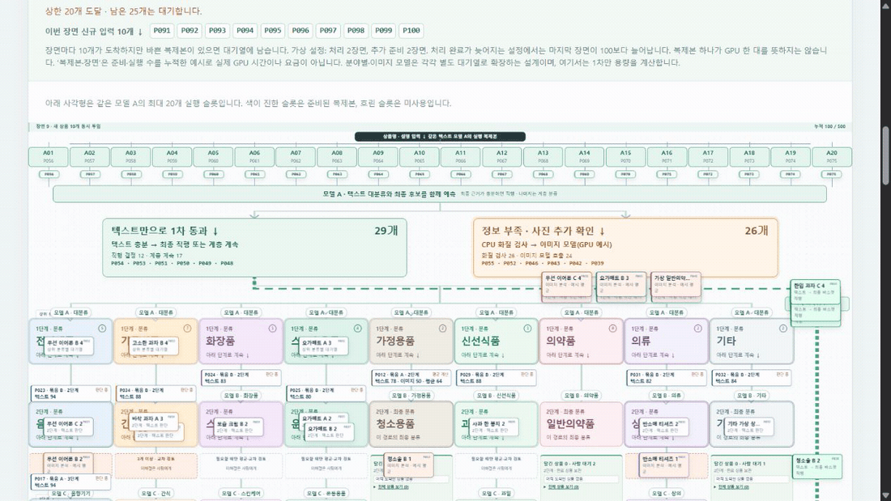
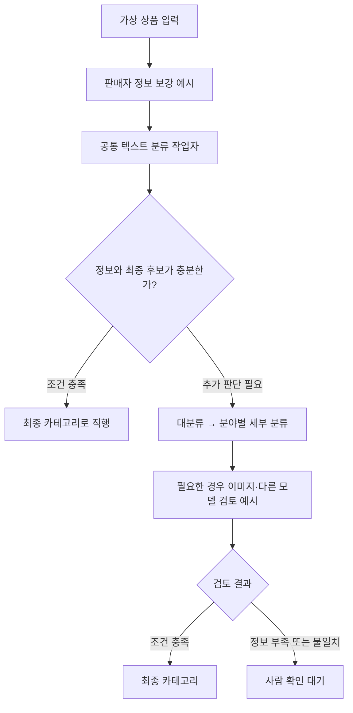
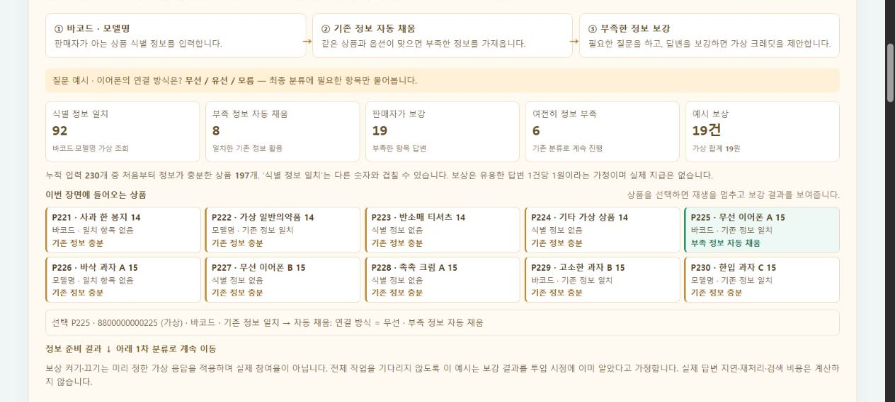
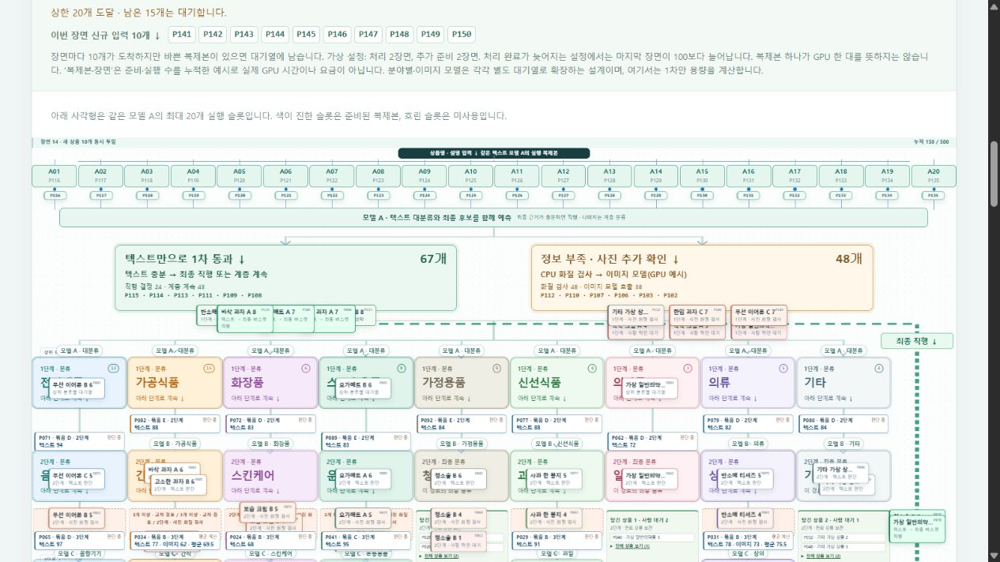

# 500만 상품의 계층 분류 흐름 시뮬레이터

판매자 정보 보강부터 텍스트 우선 분류, 최종 카테고리 직행과 단계별 검토까지 **상품이 분류되는 과정을 눈으로 살펴보는 웹 데모**입니다.

**[▶ 웹에서 직접 실행하기](https://product-category-flow.pages.dev/)**



> 위 GIF는 실행 중인 데모 화면을 캡처한 것입니다. 아래 내용과 화면의 상품·점수·작업자 수는 모두 **설명을 위한 가상 예시**입니다.

## 어떤 문제를 살펴보나요?

상품 **500만 개**를 약 **1만 개의 세부 카테고리**로 분류해야 한다는 설계 문제를 가정했습니다. 모든 상품에 같은 무거운 처리를 적용하기보다, 상품 정보가 충분한지에 따라 처리 경로를 나누면 어떤 모습일지 시각화했습니다.

실제 화면은 전체 규모를 재현하지 않습니다. **가상 상품 500개와 9개 예시 분야**를 사용하며, 분야마다 2~4단계로 다른 깊이의 분류 경로를 보여줍니다.

## 분류 흐름



이 그림은 **제안하는 처리 흐름**이며, 실제 모델과 클라우드 작업자가 연결된 구성도는 아닙니다.

## 화면에서 볼 수 있는 것

### 1. 판매자 정보 보강



바코드나 모델명이 가상 상품 정보와 일치하면 부족한 항목을 채우고, 그렇지 않으면 판매자에게 필요한 정보를 묻는 상황을 보여줍니다. 보상 제안을 켜고 끄면 미리 정해진 가상 응답과 분류 경로가 바뀝니다. **실제 조회나 보상 지급은 없습니다.**

### 2. 텍스트 우선 분류와 병렬 작업



- 같은 공통 텍스트 모델의 **가상 복제본 10개로 시작**하며, 대기열 상태에 따라 복제본을 늘리거나 줄이는 장면을 볼 수 있습니다.
- 정보가 충분하고 가상 최종 후보 점수와 상위 분류 일치 조건을 충족하면 최종 카테고리로 직행합니다.
- 정보가 부족하거나 판단이 애매한 상품은 계층별 분류와 이미지 확인·추가 검토를 거치는 예시 경로로 이동합니다.
- 여러 상품이 서로 다른 단계에서 동시에 진행하고, 결과는 카테고리별 바스켓에 누적됩니다.

자동 확장의 용량 계산은 **1차 텍스트 단계의 가상 작업자**에 적용됩니다. 하위·이미지 단계의 독립적인 실제 자동 확장은 제안 설계이며, 현재 화면에서 클라우드 자원을 생성하지 않습니다.

### 3. 직접 조작하기

1. **재생 / 한 장면 / 처음부터** 버튼이나 진행 막대를 사용합니다.
2. **가상 보상 제안**과 **자동 확장**을 켜거나 끄고 진행 상태를 비교합니다.
3. 상품을 선택해 정보 보강 내용, 현재 단계와 예시 점수를 확인합니다.
4. 최종 직행·추가 검토 기준을 조절하고 카테고리 바스켓을 살펴봅니다.

## 구현 범위와 한계

| 화면에 구현된 것 | 아직 연결되지 않은 것 |
| --- | --- |
| 500개 가상 상품의 상태 전환과 계층 경로 | 실제 500만 개 상품과 1만 개 카테고리 처리 |
| 텍스트 우선·최종 직행·이미지 검토를 나타내는 규칙 | 실제 텍스트·이미지 모델의 추론 및 모델 간 토론 |
| 1차 대기열·가상 복제본의 확장 및 축소 | GPU 임대, API 호출, 실제 클라우드 자동 확장 |
| 판매자 정보 보강·보상 응답 시나리오 | 실시간 바코드 조회, 판매자 응답 수집, 실제 보상 지급 |

화면의 **90·95·70 등의 점수와 기준은 검증되지 않은 예시 값**입니다. 실제 적용 시에는 상품별 정답 데이터로 정확도, 신뢰도 보정, 분류 오류, 처리량과 비용을 별도로 측정해야 합니다. 서로 다른 모델 점수의 단순 평균을 그대로 확률로 해석할 수도 없습니다.

## 실행 방법

서버나 별도 라이브러리 설치 없이 `index.html`을 브라우저에서 열면 됩니다. 웹에서 바로 보려면 [배포된 데모](https://product-category-flow.pages.dev/)를 이용하세요.

Node.js가 설치되어 있다면 아래 명령으로 시나리오 검사를 실행할 수 있습니다.

```bash
node tests/test-text-first.cjs
node tests/test-direct-route.cjs
node tests/test-seller-enrichment.cjs
```

이 검사는 가상 시나리오의 상태·화면 로직을 확인하며 실제 모델의 정확도나 처리 속도를 측정하지 않습니다.

## 구성

```text
index.html                   단일 파일 웹 데모 (HTML · CSS · JavaScript)
assets/classification-flow.gif  실제 데모의 재생 화면
assets/overview.jpg             데모 첫 화면
assets/seller-enrichment.jpg    판매자 정보 보강 화면
assets/classification.jpg       분류 진행 화면
tests/                       가상 시나리오 검사
```

사용자가 문제와 표현할 흐름을 정하고, Codex를 활용해 웹 화면과 시뮬레이션을 구현·수정했습니다.

## 참고 자료

- [Cross-Platform E-Commerce Product Categorization and Recategorization](https://arxiv.org/html/2508.20013v2): 텍스트 모델 후 필요한 예측에 멀티모달 모델을 적용하는 상품 분류 연구. 이 데모의 점수·비용은 논문의 실측값이 아닙니다.
- [AWS: Scale Amazon ECS services based on an Amazon SQS queue](https://docs.aws.amazon.com/AmazonECS/latest/developerguide/service-autoscaling-queue.html): 대기열 처리량에 따른 작업자 확장 설계 참고.
- [Kaufland: Product data guideline](https://www.kauflandglobalmarketplace.com/en/seller-university/selling/product-data/product-data-guideline/): 기존 상품 정보 활용과 판매자 상품 데이터 입력 참고.
